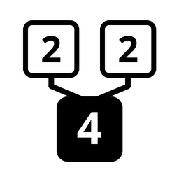
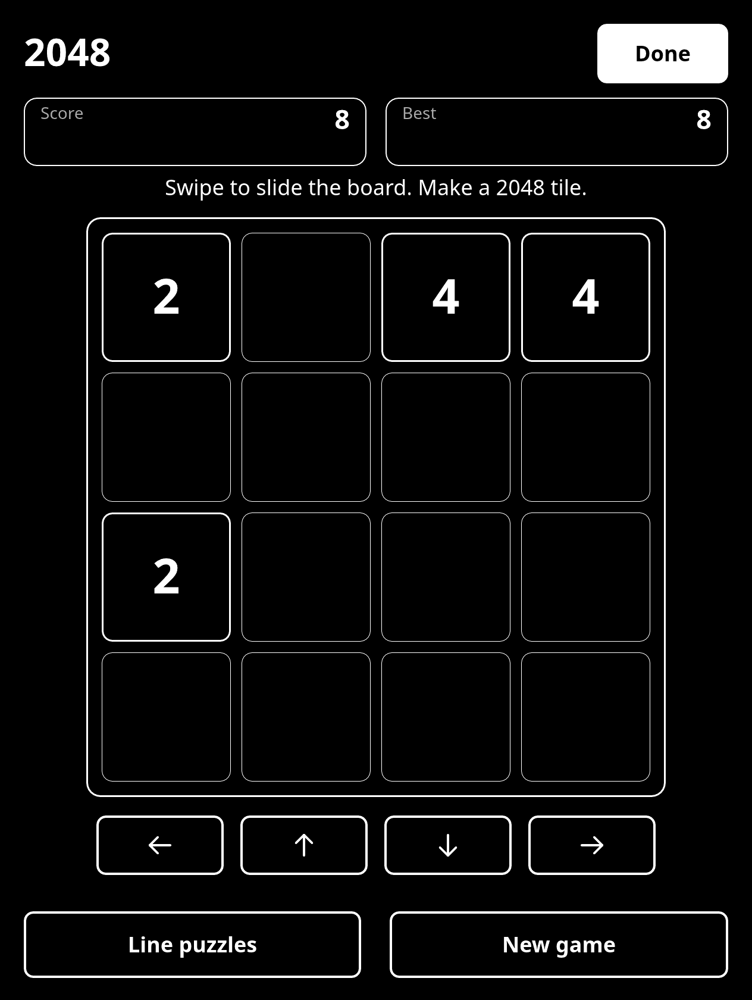

<div align="center">



# 2048

**Merge tiles and beat your best score**

[](https://github.com/PrimitiveOS/kindle-primitive-2048/actions/workflows/ci.yml)
[](https://github.com/PrimitiveOS/kindle-primitive-2048/releases)
[](https://github.com/PrimitiveOS/kindle-primitive-2048/tags)
[](LICENSE)
[](https://github.com/PrimitiveOS/kindle-primitive-2048/stargazers)
[](https://primitiveos.github.io/kindle-primitive-catalog/v1/index.json)

[**Download**](https://github.com/PrimitiveOS/kindle-primitive-2048/releases/latest) ·
[**Install guide**](INSTALL.md) ·
[**Changelog**](CHANGELOG.md)

</div>

---

Swipe to move every tile toward one edge. Matching numbers merge and add to your score. A 2 or 4 appears after each move that changes the board. Keep playing past 2048 and beat your best score before you run out of moves.

Your board and best score save between launches. The original Tidefork challenges and saved progress are available under Line puzzles.

## Quick start

After setting up PrimitiveOS, open **Store** from Primitive Launcher. Choose **2048** under **Apps**,
tap **Get**, and open it from the Launcher grid. The [install guide](INSTALL.md) also covers the standalone USB package.

## Screenshots

<table>
<tr>
<td align="center"><br><sub>A fresh 2048 board with two starting tiles</sub></td>
<td align="center"><br><sub>A 2048 board in dark mode after four swipes</sub></td>
<td align="center"><br><sub>A solved Line puzzles challenge</sub></td>
</tr>
</table>

Desktop simulation captures at 1264 × 1680 pixels.

## Develop locally

Keep the Tools and Launcher checkouts next to this repository.

```sh
cargo test --offline --locked --workspace
cargo run --offline --locked -p tidefork-desktop
```

The desktop target exercises the touch controls and writes previews to `build/previews/`.

## Highlights

- Swipe to move every tile toward one edge.
- Matching numbers merge and add to your score.
- A 2 or 4 appears after each move that changes the board.

## Status

| Device | Status |
|---|---|
| Kindle Oasis 3 (1264 × 1680, firmware 5.18.2) | Tested on hardware |

**Current version: 0.1.4.** Changes are in [CHANGELOG.md](CHANGELOG.md).

## Downloads

The badge at the top shows the number of Store downloads. It counts GitHub downloads of this app's release packages, across all versions and architectures, and is refreshed daily from the [Store catalog](https://primitiveos.github.io/kindle-primitive-catalog/v1/index.json).

## Documentation

[Install guide](INSTALL.md) · [Changelog](CHANGELOG.md)

## Licence

Copyright (C) 2026 Doan Nguyen.

Code is licensed under [PolyForm Noncommercial 1.0.0](LICENSE). The documentation and original art are
licensed under [CC BY-NC-SA 4.0](LICENSE-DOCS).
