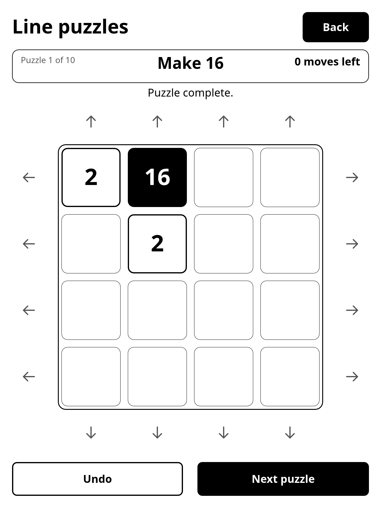

# 2048

**Swipe the board and merge matching tiles to reach 2048.**

2048 is a native number game for PrimitiveOS with swipe controls and large direction buttons for Kindle.

## How to play

- **Slide the whole board.** Swipe across the board or tap a direction button below it. All tiles slide as far as they can in that direction.
- **Merge equal tiles.** Two matching tiles become one tile worth their sum. Each tile can merge once per move. You earn the new tile's value, and a new 2 or 4 appears after a move that changes the board.
- **Reach 2048.** Keep playing for a higher score while moves remain. **New game** resets the board and keeps your best score.

Your board saves between launches. Open **Line puzzles** to play the ten original Tidefork challenges, one row or column at a time. Existing puzzle progress carries forward. **Done** returns to Launcher.

## Screenshots

<table>
<tr>
<td align="center"><br><sub>A fresh 2048 board with two starting tiles</sub></td>
<td align="center"><br><sub>A 2048 board in dark mode after four swipes</sub></td>
<td align="center"><br><sub>A solved Line puzzles challenge</sub></td>
</tr>
</table>

Desktop simulation captures at 1264 × 1680 pixels.

## Install

After setting up PrimitiveOS, open **Store** from Launcher. Find **2048** under **Apps** and choose **Get**.
See the [installation guide](INSTALL.md) for the local build workflow.

## Develop locally

Keep the Tools and Launcher checkouts next to this repository.

```sh
cargo test --offline --locked --workspace
cargo run --offline --locked -p tidefork-desktop
```

The desktop target exercises the touch controls and writes previews to `build/previews/`.

## Licence

Copyright (C) 2026 Doan Nguyen.

Code is licensed under [PolyForm Noncommercial 1.0.0](LICENSE). The documentation and original art are
licensed under [CC BY-NC-SA 4.0](LICENSE-DOCS).
