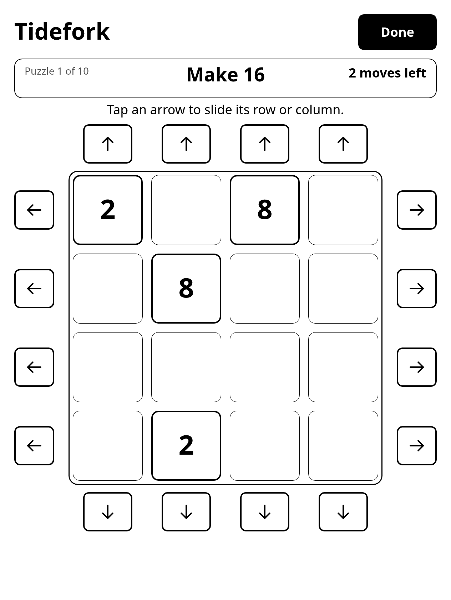

# Tidefork

**Slide a row or column to make the target tile.**

A native game for PrimitiveOS. Tap an arrow at the edge of the board to slide only that row or column. Equal tiles fuse when they meet. Make the target tile before the puzzle runs out of moves.

## How to play

- **Move one line**. Tap the arrow at the end you want the tiles to slide toward.
- **Merge equal tiles**. Each tile can merge once per move. A slide that changes nothing costs no move.
- **Solve ten puzzles**. Reach the target to unlock the next puzzle. Use Undo to take back a move or reset to try a different route.

Progress saves between launches. **Done** returns to Launcher.

## Screenshots

<table>
<tr>
<td align="center"><br><sub>The first puzzle has a target of 16 with two moves left</sub></td>
<td align="center"><br><sub>A partly solved puzzle in dark mode</sub></td>
<td align="center"><br><sub>The target tile has been made</sub></td>
</tr>
</table>

Desktop simulation captures at 1264 × 1680 pixels.

## Install

After setting up PrimitiveOS, open **Store** from Launcher. Find **Tidefork** under **Apps** and choose **Get**.
See the [installation guide](INSTALL.md) for the local build workflow.

## Develop locally

Keep the Tools and Launcher checkouts next to this repository.

```sh
cargo test --offline --locked --workspace
cargo run --offline --locked -p tidefork-desktop
```

The desktop target exercises the touch controls and writes previews to `build/previews/`.

## Licence

Copyright (C) 2026 Doan Nguyen.

Code is licensed under [PolyForm Noncommercial 1.0.0](LICENSE). The documentation and original art are
licensed under [CC BY-NC-SA 4.0](LICENSE-DOCS).
